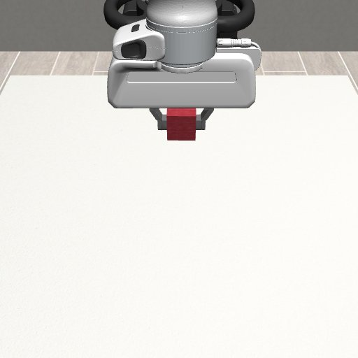

# hy-stem robotics rollout 验收（2026-11-01）

真实 Gemini 最终 **6/8** 个组合通过独立物理评分。协议矩阵另有 **8/8** 通过。两类结果分开统计；协议测试使用确定性模型，不代表 LLM 能力。

实现提交：`52a96bef82ce755066c903c2ab0e1d0b1a6876f3`。共享 runtime 为 robot-rollout v0.5.1；CC 2.1.296、官方 DSH/ACP 0.1.0-rc.6、Node 22.23.2。完整版本和逐例证据见 [evidence.json](evidence.json)。

## 真实模型

模型为用户指定服务上的 `gemini/gemini-4-argon` 别名，temperature=0.2，seed=17，每格一次，另有一次基础设施失败重试；上游权重快照不可见。任务来自同一 Harbor 包。入口使用 YAML → 标准 slime generate hook → Sample → 官方 CLI → HTTP MCP → MuJoCo；正常结束后由独立 verifier 评分。没有人工注入运动轨迹或修改模拟器状态。

| 任务 | Harness | 模式 | 状态 / 分数 | 模型请求 | 物理动作 | 成功深度程序 | PTC 成功子调用 | 墙钟秒 |
|---|---|---|---|---:|---:|---:|---:|---:|
| panda-reach | CC | intuitive | completed / 1.0 | 6 | 3 | 0.0 | 0 | 164.224 |
| panda-reach | CC | expert | completed / 1.0 | 3 | 3 | 1.0 | 0 | 66.706 |
| panda-reach | DSH | intuitive | completed / 1.0 | 6 | 2 | 0.0 | 0 | 166.053 |
| panda-reach | DSH | expert | completed / 1.0 | 3 | 2 | 1.0 | 3 | 137.361 |
| panda-lift | CC | intuitive | completed / 1.0 | 17 | 8 | 0.0 | 0 | 254.569 |
| panda-lift | CC | expert | completed / 1.0 | 6 | 8 | 3.0 | 0 | 263.264 |
| panda-lift | DSH | intuitive | aborted / null | 3 | 0 | — | 0 | 82.626 |
| panda-lift | DSH | expert | aborted / null | 7 | 6 | — | 8 | 175.092 |

首轮 DSH/intuitive/Lift 遭遇上游 HTTP 429 RESOURCE_EXHAUSTED（LiteLLM 重试耗尽），框架记为 aborted、无有效 reward。随后仅对该基础设施失败单并发重试，prompt、工具权限、seed 和评分未变；重试仍收到 HTTP 500 PlatformNoAvailableAccount。首次失败保留在 evidence.json 的 superseded_live_attempts。DSH/expert/Lift 已完成物理抬升，但最终模型请求同样返回 HTTP 500，因此也记为 aborted，不能算端到端通过。表中 DSH/intuitive/Lift 是重试记录，其他行为首轮记录。

成功要求真实物理动作后连续 10 个 20 Hz 样本达标。Lift 使用 robosuite 原生成功判定；专家模式还要求 Python 程序实际加载并分析当前测量深度。JSON 包含这些状态、程序、图片计数和最终 RGB 的 SHA-256。直觉模式没有深度或代码工具；DSH 专家模式实际启用 PTC。

### 专家模式最终 Lift

CC：

DSH（最终图像显示物理抬升；上游请求失败，整体运行仍是 aborted）：

## 协议与边界测试

| 上游协议 | Harness | 模式 | 分数 | 模型收到的图片块 | 深度程序 | PTC 成功子调用 |
|---|---|---|---:|---:|---:|---:|
| openai | CC | intuitive | 1.0 | 6 | 0.0 | 0 |
| openai | CC | expert | 1.0 | 8 | 1.0 | 0 |
| openai | DSH | intuitive | 1.0 | 6 | 0.0 | 0 |
| openai | DSH | expert | 1.0 | 8 | 1.0 | 3 |
| anthropic | CC | intuitive | 1.0 | 6 | 0.0 | 0 |
| anthropic | CC | expert | 1.0 | 8 | 1.0 | 0 |
| anthropic | DSH | intuitive | 1.0 | 6 | 0.0 | 0 |
| anthropic | DSH | expert | 1.0 | 8 | 1.0 | 3 |

- 真 CC 不做动作直接结束：completed，reward=0，证明正常任务失败不被标成基础设施故障。
- 真 CC 强制触发压缩、max_compactions=0：truncated、compact_limit_reached=1、reward=0；没有偷偷继续请求模型。
- hy-stem：23 项 robotics 测试和 29 项原 harness/启动测试通过。官方 Harbor 0.25.0 的包校验在本地通过；本地 robotics 全部 24 项通过。
- Ruff、Black、isort 与 git diff 检查通过；公开提交未包含 API key、临时 MCP token 或运行配置凭据。

## 修复与版本边界

专家协议测试最初暴露 uv Python 的基础解释器未挂入 Bubblewrap，已在 robot-rollout v0.5.1 修复，并验证系统 Python 与 uv Python 两条路径。测试期间 Docker 的 /data 存储耗尽导致启动失败；只清理了本任务的旧镜像/构建缓存，并修复启动锁创建失败被误当重复启动的处理。CC 压缩 hook 现在显式加载受控 settings，且文件可由 agent 读取。

新增回归还覆盖取消/异常/超时先冻结机器人、DSH 模型注册表不能覆盖回合网关、环境 CC 参数隔离、直觉模式禁止额外 MCP、任务摘要忽略本地 Python 缓存但能检测任务源码变化。

本次只验证 rollout/evaluation，没有跑 RL 训练或真机。单 seed 验收不能解释为多 seed 成功率；模型延迟包括服务端等待，首轮并发为 2，不能据此比较 harness 速度。验证了 CC 压缩预算停止机制，未验证长任务压缩后的模型能力或 DSH 长上下文表现。

复现入口和依赖安装见 [模块 README](../README.md)。原始轨迹保留在 hy-stem 的模块 runs/ 目录；本目录只发布筛选后的证据和图像。
